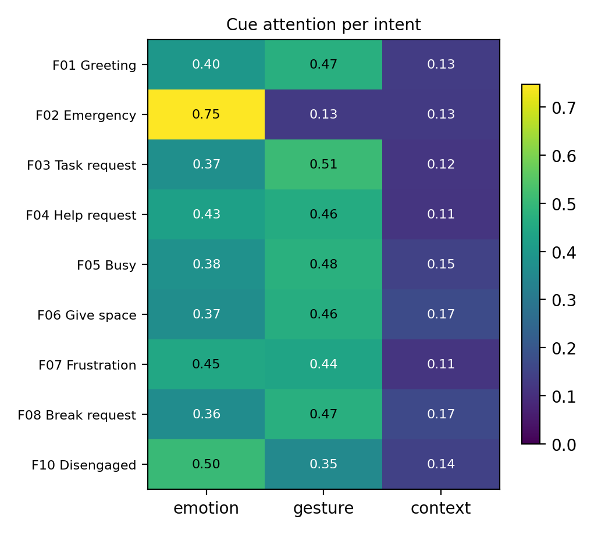

# WP7 - what the fusion model attends to

CLS-token attention over the three cue tokens, averaged over layers, over 5 seeds, and over the test clips of each intent. Rows sum to 1: they show the share of evidence the model drew from each cue when producing the representation it classified from.

| intent | meaning | clips | emotion | gesture | context |
|---|---|---|---|---|---|
| **F01** | Greeting | 146 | 0.396 | 0.471 | 0.134 |
| **F02** | Emergency | 38 | 0.747 | 0.127 | 0.126 |
| **F03** | Task request | 95 | 0.371 | 0.510 | 0.119 |
| **F04** | Help request | 80 | 0.426 | 0.460 | 0.114 |
| **F05** | Busy | 80 | 0.379 | 0.475 | 0.146 |
| **F06** | Give space | 53 | 0.365 | 0.465 | 0.170 |
| **F07** | Frustration | 146 | 0.449 | 0.437 | 0.114 |
| **F08** | Break request | 41 | 0.363 | 0.472 | 0.165 |
| **F10** | Disengaged | 94 | 0.505 | 0.351 | 0.144 |

## Does the model use the evidence the taxonomy says it should?

The v4 rubric defines F02/F06/F07/F08/F10 by emotion overriding or qualifying the gesture, while F01/F03/F04/F05 are led by the gesture itself. If the model learned the intended structure, the first group should draw more on the emotion token.

- emotion-defined intents: mean emotion attention **0.486**
- gesture-defined intents: mean emotion attention **0.393**
- difference: **+0.093**

The model does place more weight on emotion exactly where the taxonomy requires it, which is evidence that it learned the intended decision structure rather than a surface correlation.

